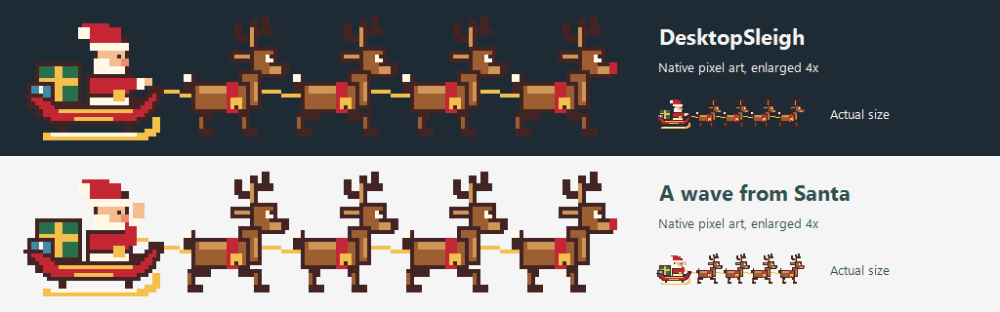

# DesktopSleigh

Santa and four reindeer take a trip around the edges of your Windows desktop.

Every 30 seconds the team stops, Santa waves, and the sleigh bells ring.
Left-click to ring the bells yourself. Right-click for options.

[Running, building, and checks](BUILDING.md).

A festive fork of [Steve Syfuhs' DesktopDuck](https://github.com/SteveSyfuhs/DesktopDuck).
Code is [MIT licensed](LICENSE), with the original copyright notice retained.
[Bell recording credit and license](Assets/AUDIO-LICENSE.md).
